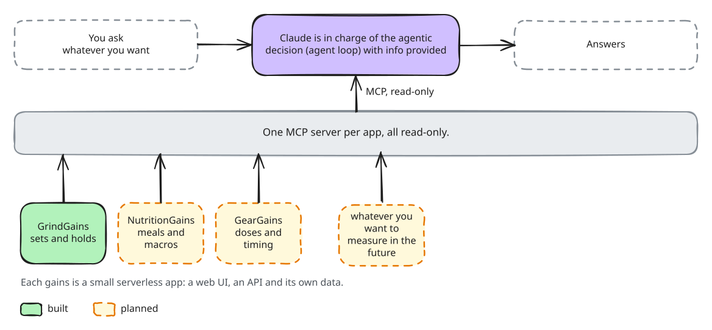
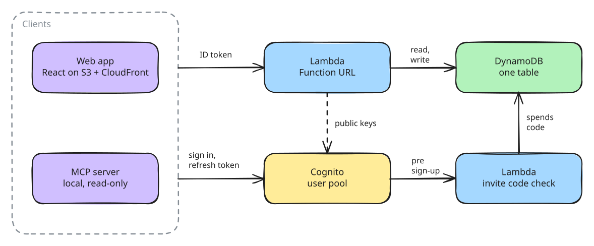
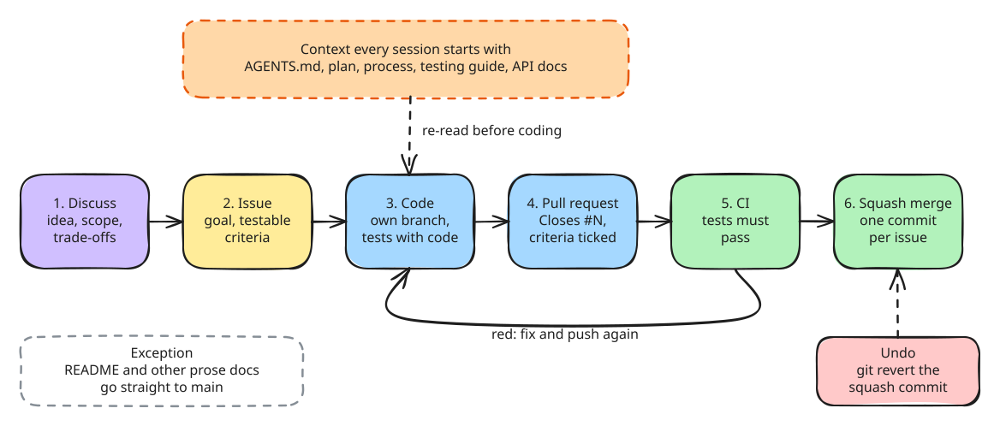

# GrindGains Backend

"What Gets Measured gets managed" - V.F. Ridgway, 1956.

[Live app](https://grindgains.junfa-li.me) · [Frontend repo](https://github.com/IHIDY/GrindGains-Frontend) · [Ask Claude about your training](mcp-server/)

## Ambition

GrindGains is the first piece of a bigger plan: a personal progress system made of many small apps, one for each part of life that can be tracked and improved. Training is built. Nutrition, peptides, sleep, body measurements, the calendar and studying are planned, and the list will grow.

Every app follows the same recipe: a small serverless backend, a web UI, and a read-only MCP server with the same conventions (local dates, explicit units, one account). The payoff is the top of the diagram: Claude can read all the logs in one conversation and answer questions like "how is my month going?" from facts instead of guesses.

## How it works

## How it was built

This project is built with Claude Code, and every change follows the same loop. The idea is talked through first, then written up as an issue with a goal and acceptance criteria that a test can prove. The work happens on its own branch with the tests in the same pull request, and the pull request ticks off each criterion with its evidence. CI has to be green before a squash merge, so each issue is one commit that can be reverted on its own.

Every session starts by reading the same context files, so a fresh agent knows the spec, the process and how to test. Criteria that need a real account, such as signing in through Claude Desktop, stay unticked and keep the issue open until they are done. README and other prose edits skip the loop and go straight to `main`. The full rules are in [`_docs/process.md`](_docs/process.md).

## Documentation

- [API and data model](docs/api.md): every endpoint, field and error
- [Authentication and sign-up](docs/auth.md): token checks, invite codes, usernames, calling the API from a client
- [Deploying and running your own](docs/deploy.md): the stack, deploy steps, invite codes, permissions
- [MCP server](mcp-server/README.md): let Claude read your training log

Working on this repo with an AI agent? Start with [AGENTS.md](AGENTS.md).

## Known gaps

- No rate limiting on the Function URL. Fine at personal scale, but a script could flood it.
- No pagination. Listing every movement reads all of a user's logs, so it is the first call to watch as history grows.
- No password reset in the web app yet.
- The tests do not cover `src/auth.py` or the sign-up trigger yet.
